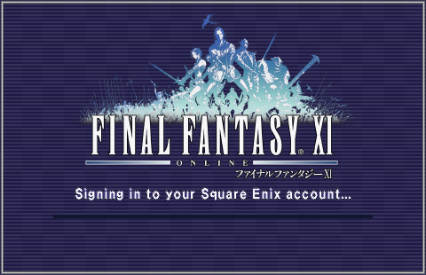

# BegonePOL

**Make PlayOnline disappear.** BegonePOL is an [Ashita v4](https://www.ashitaxi.com/) POL plugin that
takes you from clicking Play to FINAL FANTASY XI's title screen without ever seeing PlayOnline. It
hides the POL window behind a splash screen, logs in for you by calling the viewer's own UI code from
inside pol.exe (no window focus, simulated keystrokes or clipboard, unlike autoPOL), and skips POL's
main menu so FFXI starts straight after the login. It replaces both autoPOL and Ashita's `quicky`.

Your login lives in your desktop keyring (GNOME Keyring, KWallet, KeePassXC...), never in a plain text
file. Square Enix one-time passwords (2FA) are supported: typed into the splash when asked, or
generated automatically from your authenticator key if you choose.

<p align="center">
  
  
</p>

The splash is drawn with the game's own title logo, menu window and font, read at runtime from your
FFXI install. No Square Enix data is included in this repository or the release.

> **Linux only (Wine/Proton).** The keyring hand-off goes through `$XDG_RUNTIME_DIR`, which only
> exists on Linux. Developed and tested with [Faugus Launcher](https://github.com/Faugus/faugus-launcher)
> (Proton) on retail FFXI, North American client.
>
> Not affiliated with or endorsed by Square Enix. Automating the PlayOnline login is a grey area under
> the PlayOnline/FFXI terms of use, as with autoPOL and quicky; use it at your own risk.

## Install
1. Have FFXI working through Ashita v4 in a Wine/Proton prefix, and log in to PlayOnline by hand at
   least once so your member(s) exist.
2. Copy `BegonePOL.dll` (from the [latest release](../../releases/latest)) into `Ashita/polplugins/`.
3. In your Ashita boot ini (`Ashita/config/boot/<name>.ini`):
   ```ini
   [ashita.polplugins]
   BegonePOL = 1
   quicky    = 0

   [ashita.polplugins.args]
   BegonePOL =
   ```
   Turn off autoPOL and any other login plugin.
4. Put `begonepol-helper.py` somewhere your launcher can read and make it executable. It needs
   Python 3 with PyGObject, GTK 4, libadwaita and libsecret; the Faugus flatpak already has them.
5. Set it as the game's pre-launch command, with the row of your PlayOnline member in the member list:
   `/path/to/begonepol-helper.py --slot 1`.
   With the Faugus flatpak, also let it reach the keyring:
   `flatpak override --user --talk-name=org.freedesktop.secrets io.github.Faugus.faugus-launcher`
6. Launch. The first time, a setup window asks for your Square Enix ID, password and one-time password
   settings and saves them to the keyring; after that, launches go straight in.
   To change the login later, run `begonepol-helper.py --setup` (or install
   `packaging/begonepol-setup.desktop`, after editing its path, for an app-menu entry).

If anything fails, PlayOnline is shown again so you can log in yourself. Ashita's log
(`Ashita/logs/`) says why.

## How it works
1. **Hide POL.** A CBT hook on every thread catches the POL window (class `PlayOnline<region>`) and
   POL's untitled start-up dialog (which Wine draws as a white box) as they are created, and keeps
   them layered at zero opacity, click-through and off the taskbar. Wine ignores styles changed in
   the CBT hook itself, so they are applied from the window's own WM_CREATE and pinned through
   WM_STYLECHANGING until FFXI takes over. A small splash window ("FINAL FANTASY XI - logging in")
   shows progress until the FFXI window appears. It is drawn with the game's own artwork, read at
   runtime from the user's FFXI install (`src/xiart.h`; nothing of the game's is shipped): the title
   logo (`menu titlwin` in ROM/176/74.DAT), the default menu window tile and frame (ROM/0/14.DAT) and
   the text font (`font moji` in ROM/0/1.DAT). If those can't be read it falls back to plain GDI.
   `preview/preview.exe "<FFXI folder>\"` renders it to BMP files without starting PlayOnline.
2. **Log in** (each step waits ~0.3s for the screen to settle, then runs once on the UI thread):
   member list → select row `slot` through the list's selection model; member screen
   (Log In / Settings / Delete / Back) → Log In (or Back if the wrong member is open);
   Square Enix ID screen → set the password (and one-time password) fields and press Login. Submitted once, never retried.
3. **Skip the POL menu** (quicky's idea, own code in `src/quicklaunch.h`). After the login POL fetches
   `GET /pml/main/index.pml` from the content server on port 51304. Inline hooks on ws2_32
   `connect/send/recv/select/__WSAFDIsSet/closesocket` fake that connection and answer with a PML page
   whose `onopen` is `gameto:1` (start FFXI). Differences from quicky: the connection is never actually
   made (connect reports "in progress", select reports ready on the first call instead of the third),
   and the two fade loops in app.dll's hand-off (30 + 12 frames x 16 ms) are found by signature
   rather than fixed offsets.
4. **Skip the logo wait** (on by default; arg `logowait` turns it off). pol.exe keeps its PlayOnline logo
   dialog (the untitled #32770 box BegonePOL hides) up for at least 5 seconds (pol.exe FUN_00406a10:
   `cmp eax, 5000` in a 100ms Sleep loop) before showing the main window. Both compares are patched to 0,
   so the login screen is ready ~1-2s after load instead of ~7s (real login 27.6s -> 24.3s to in game).
   Nothing waits on those seconds (no network traffic, no other thread). One early run ended in
   "unknown error 0x80004002" when POL started FFXI; it hasn't happened since. As a safety net,
   pol.exe's `_com_issue_error` (0x43D130) is hooked: a COM failure after a skip is logged with its
   HRESULT and call stack, and `polplugins\BegonePOL.logowait` is created so later launches keep the
   wait (delete it to try the skip again).

Everything in app.dll is found at load time via RTTI vtables and byte signatures, so a POL update
fails loudly ("signatures not found") instead of poking the wrong memory; POL then just behaves normally.

## Config
- **Login: the desktop keyring**, kept by `begonepol-helper.py` (GTK 4/libadwaita, runs inside the Faugus
  sandbox). Faugus runs it as the entry's pre-launch command:
  - Login saved → it writes `$XDG_RUNTIME_DIR/begonepol/login` (tmpfs, mode 600; `account=`, `slot=`,
    `otp=off|manual|auto`, `password=`, `totp=`) and deletes it after 2 minutes if nothing read it. The
    plugin finds it under `Z:\run\user\*` (Proton hides XDG_RUNTIME_DIR from Windows programs), reads it
    once and deletes it.
  - Nothing saved (first run) → it creates a `setup` marker in that folder and opens the setup window;
    the plugin waits (up to 30 min) while the marker exists. Save → stored and handed over; Cancel →
    POL comes up normally for a manual login.
  - Several logins: one keyring item per Square Enix ID + member row. The Faugus pre-launch passes
    `--slot <member row>` to say which one (add another launcher entry with a different `--slot` for
    another member).
    The setup window has a "Saved login" picker when there is more than one.
  - Change it later with `begonepol-helper.py --setup` (see `packaging/begonepol-setup.desktop`).
    An empty password field keeps the saved one.
  - Keyring item: label `FINAL FANTASY XI - BegonePOL (<Square Enix ID>)`, attributes
    `application=begonepol account slot otp`, secret JSON `{"password", "totp"}`. Faugus needs
    `flatpak override --user --talk-name=org.freedesktop.secrets io.github.Faugus.faugus-launcher`.
- **One-time passwords** (Square Enix two-step verification), two settings in the window:
  "Do you have a one-time password (MFA/2FA)?" and "Automatically handle MFA?".
  - Off: nothing entered. If POL shows the code box anyway, BegonePOL asks for the code (manual).
  - Manual: a code box appears on the splash at the login screen; it signs in at 6 digits (Enter also
    works), Esc shows POL so you can log in yourself. No time limit while it waits.
  - Auto: the setup key (base32, from "Can't scan?" when adding an authenticator) is stored too and
    the plugin makes the RFC 6238 code itself (`src/totp.h`, SHA1/30s/6 digits; skips to the next
    window if under 4s are left). The window shows the current code to compare with the phone app.
    Storing the key next to the password means the keyring holds both factors.
  - The POL member must have its one-time password turned on in its PlayOnline Settings (flag at
    member login settings +0x536B); if the saved login uses OTP but the member doesn't, BegonePOL stops
    and says so. The OTP box is login screen +0x2A8, a CTextField (confirmed on a member that uses 2FA, dry run).
- **POL not set up**: the member count (`*g_MemberStore + 0x50`, found via the "Add Member" check) is
  read at the member list. No members → POL is shown with a message to add a member and log in once by
  hand; saved member row past the end of the list → POL shown with a message to fix it in setup.
- Secrets are held scrambled or in fixed buffers and zeroed after use. Nothing secret is logged.
- Boot ini `[ashita.polplugins]`: `BegonePOL = 1`, `quicky = 0`.
- `[ashita.polplugins.args]`: `BegonePOL = [options]` (empty normally)
  - `slot=<n>`: override the saved member row.
  - `show`: don't hide the POL window. `nosplash`: no splash window.
  - `menu`: don't skip POL's main menu. `realconnect`: connect to the content server like quicky does.
  - `dryrun`: stop before pressing Login (nothing is sent to Square Enix). With it, `testmembers=<n>`
    pretends POL has n members, and an OTP mode runs even if the member doesn't use one.
    `askcode` (with `dryrun`) shows the one-time password prompt even when the login doesn't use one.
  - `trace`: diagnostics (screen state, window creation, network connects with timings).
  - `prof`: log where PlayOnline sleeps (Sleep/SleepEx import swaps, per call site, once a second).
  - `dump`: write unpacked POL modules to `C:\Ashita\logs\pol-dump\`.
- Gives up after 3 minutes; POL is shown again if the login fails or FFXI doesn't start within 60s.

## Build
On Linux, with LLVM (clang-cl, lld-link) and the MSVC CRT/Windows SDK from
[xwin](https://github.com/Jake-Shadle/xwin) (`xwin --accept-license --arch x86 splat --output ~/.xwin`):

```sh
ASHITA_DIR=~/Games/ffxi/drive_c/Ashita ./build-msvc.sh          # -> build-msvc/BegonePOL.dll
ASHITA_DIR=~/Games/ffxi/drive_c/Ashita ./build-msvc.sh install  # also copies it into polplugins
```
The Ashita SDK headers come from your Ashita install (`plugins/sdk`). `preview/build.sh` builds a small
tool that renders the splash to BMP files without starting PlayOnline.

## Timing (traced run)
Faugus → Ashita 7s · POL start to login screen 5.5s · BegonePOL login steps ~1s ·
Square Enix login ~10s (network: ports 54000, 51240, 51244, 51220 x7) · menu skip → FFXI window 3.4s ·
FFXI title + character select (Ashita `autologin` addon) 7.5s. ~36s total.

## Known limitations
- A real login with a one-time password has only been tested as a dry run (prompt and code entry up
  to the Login button); logins without one are tested end to end.
- Only the North American retail client has been tested; signatures should fail safely elsewhere.

## License
GPL-3.0-or-later (see `LICENSE`). Builds against the Ashita v4 SDK, which is GPL-3.0.
